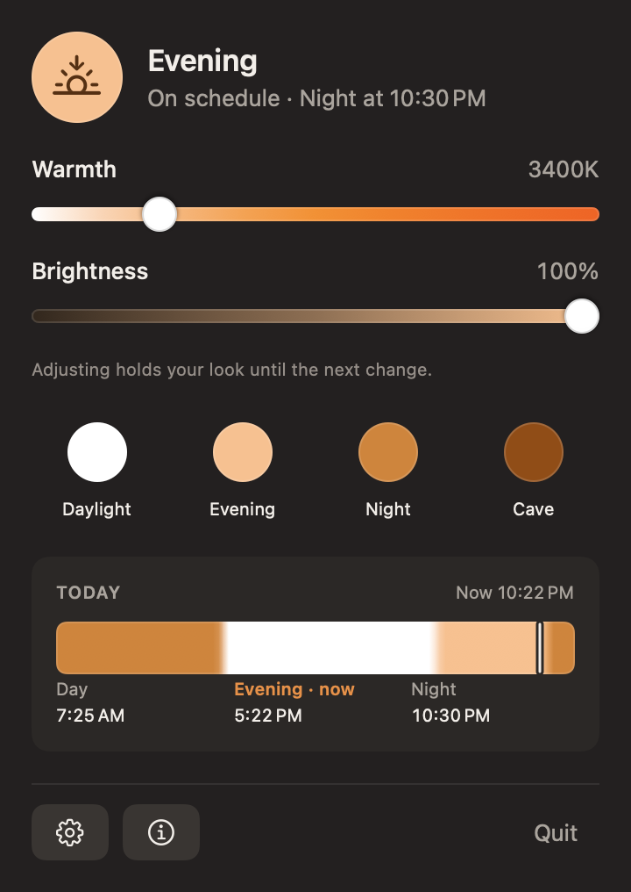
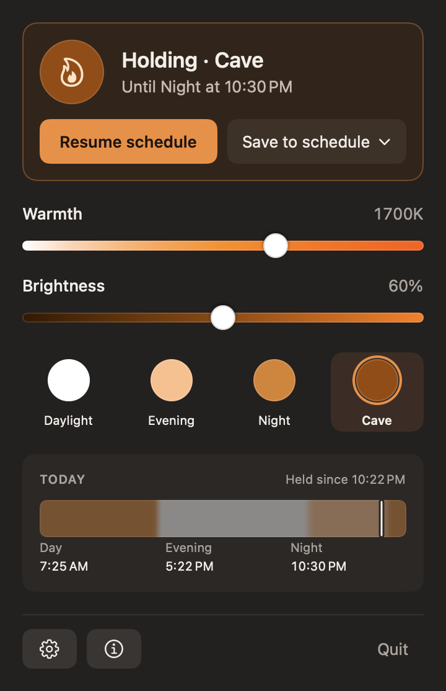
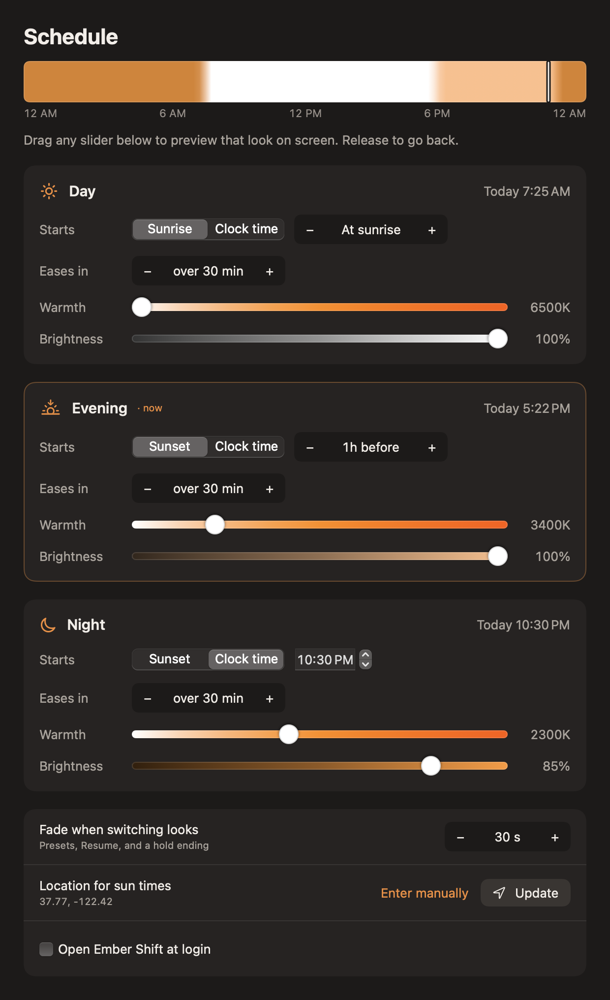

# Ember Shift

A macOS menu bar app that warms and dims your screen as the day winds down, and lets you take over whenever you want.

<p>
  
  
</p>

## Why

f.lux and Night Shift both follow the sun and give you little say in it. Ember Shift is built around overriding:

- **Holds beat the schedule.** Move a slider or click a preset and that look holds until the schedule's next change, or until you click *Resume schedule*.
- **Warmth and brightness are separate.** Brightness dims through the gamma table, so it goes below macOS's minimum.
- **The schedule is yours.** Day, Evening and Night each start at sunrise or sunset plus or minus an offset (say, an hour before sunset) or at a clock time, and each eases in over its own number of minutes.
- **True color when you need it.** Right-click the menu bar icon, or click *Turn off* in the panel, to show true color for 15 minutes, an hour, until morning, or until you turn it back on.
- **Switches are smooth.** Presets, Resume and a hold ending fade over 30 seconds (adjustable). Slider drags are instant.
- **It stays put.** Every 3 seconds, and on wake or display changes, Ember Shift checks each display's gamma table and re-applies its tint if macOS or another app reset it.
- **Private.** Your location is used only on your Mac to compute sunrise and sunset. The app makes no network requests.



## Install from source

Requirements: macOS 15 or later, and Swift 6 (Xcode or the Command Line Tools: `xcode-select --install`).

```sh
git clone https://github.com/chuckconway/ember-shift.git
cd ember-shift
./build-app.sh
open ~/Applications/"Ember Shift.app"
```

`build-app.sh` runs the checks, builds a release binary, signs it, and installs `Ember Shift.app` to `~/Applications`. On first launch it asks for your location; you can decline and enter coordinates in Settings instead.

Before running it, quit f.lux and turn off Night Shift (System Settings → Displays → Night Shift). All three write the same gamma tables and will fight.

## Known limitations

- **Some displays ignore gamma tables**: DisplayLink docks, Sidecar and AirPlay displays aren't tinted.
- **Screenshots and screen recordings don't show the tint.** It's applied after the image is captured.
- **It can't harm your monitor.** Ember Shift only changes the Mac's color lookup table (the same mechanism calibration tools use). It never touches the monitor's backlight, firmware or settings, and macOS resets the table when the app quits, crashes or the Mac restarts.
- **Turn it off for color-critical work** such as photo or video editing: right-click the menu bar icon or use *Turn off* in the panel.
- **Builds from source are ad hoc signed**, so macOS may ask for location permission again after each rebuild.

## Development

| Command | What it does |
| --- | --- |
| `swift run EmberChecks` | Core checks: color math, sun times against reference values, schedule easing |
| `swift run EmberKitChecks` | Controller checks with a fake clock and display: holds ending at the next change, fades, previews, relaunch, tint repair |
| `swift run EmberSnapshot <dir>` | Renders the panel, schedule window and About window to PNGs offscreen, without touching the display |
| `./build-app.sh` | Checks, release build, sign, install |

The code lives in three modules. `EmberCore` holds the pure logic: color temperature, the NOAA sunrise equation and the schedule. `EmberKit` holds the controller, the gamma output and the SwiftUI views. `Ember` is the app entry point.

The Command Line Tools don't ship XCTest or a usable Swift Testing, so the checks run as an executable.

Releasing signed, notarized builds is described in [RELEASING.md](RELEASING.md).

## License

[MIT](LICENSE)
